# FileForge

自用的本地文件管理器 + APK 检查器。功能取向参考 MT 管理器，代码全部原创；反编译产物只用于了解其技术选型，未复制任何代码、资源或 UI。

## 边界

- **纯本地**：不申请 `INTERNET` 权限，无插件市场、无统计、无登录、无支付。
- **不接商业 SDK**：只用开源件。
- **不做**：APK 回编、签名伪造、绕过任何应用的登录/会员校验。

## 技术栈对照

| 能力 | MT 管理器（观察所得） | 本项目 |
| --- | --- | --- |
| UI | 全代码构建，无 layout XML | Jetpack Compose + Material3 |
| 归档 | sevenzipjbinding（7-Zip JNI）+ zstd-jni | `java.util.zip`（zip/jar）+ commons-compress（7z）+ junrar（rar4） |
| DEX/ARSC | 自研，未用 dexlib2/apktool | 自研只读解析器（`apk/DexParser.kt`、`apk/AxmlParser.kt`） |
| 签名 | BouncyCastle | apksig（Apache-2.0）：v1/v2/v3 完整校验 |
| 特权访问 | Shizuku + Dhizuku + root | 先只用 `MANAGE_EXTERNAL_STORAGE`，后续可选接 Shizuku |
| 媒体 | FFmpeg JNI | 不做 |
| 加固 | libmtprotect 自研壳 | 不加固（自用） |

## 目录

```
app/src/main/java/dev/fileforge/
├── core/        FileOps（复制/移动/删除/重命名）、ArchiveBrowser（zip/7z/rar 浏览与解压）、
│                ArchiveFormats（魔数识别）、ArchiveOps（解压/打包）、FilePreview（预览分流）
├── apk/         AxmlParser（二进制清单）、DexParser（native 批量扫描 + Kotlin 回退）、ApkInspector（apksig 校验）
├── ndk/         NativeBridge（JNI 桥：sendfile / memchr / scanDex，加载失败自动回退）
├── ui/          BrowserScreen（双栏）、ApkScreen（四个标签）、ViewerScreen（查看器）、BrowserViewModel
└── util/
app/src/main/cpp/  native.cpp（sendfile 零拷贝、memchr 字节搜索、DEX 批量扫描）
tools/parser-check/ 纯 JVM 验证脚本，可脱离 Android 跑真机样本
```

## 构建

需要 JDK 17+（Android Studio 自带 JBR 21 即可）、SDK 36、NDK 25.2。

```bash
JAVA_HOME="/Applications/Android Studio.app/Contents/jbr/Contents/Home" \
  ~/.gradle/wrapper/dists/gradle-9.3.1-bin/*/gradle-9.3.1/bin/gradle assembleDebug
```

产物：`app/build/outputs/apk/debug/app-debug.apk`（约 10 MB，含 arm64-v8a / armeabi-v7a / x86_64）。

## 界面

| 文件列表 | 双栏（横屏 ≥720dp） |
| --- | --- |
| 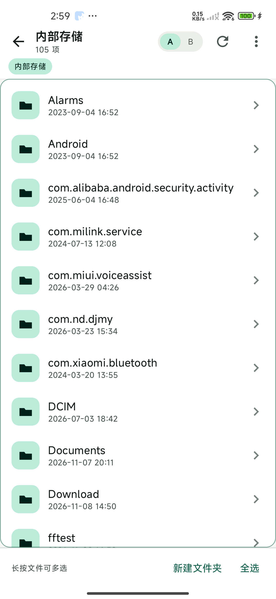 | 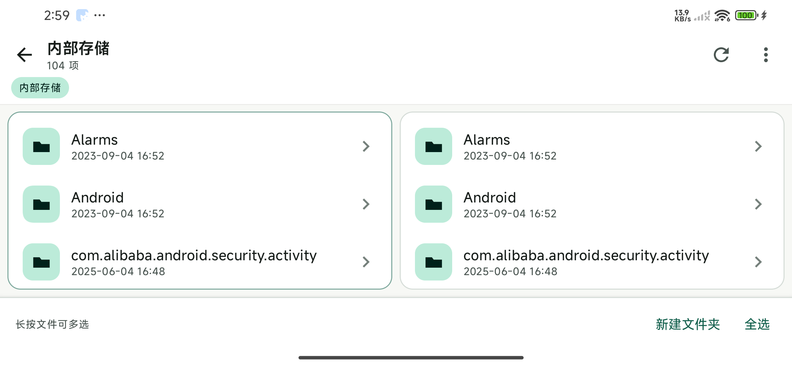 |

| APK 概览 | 内容占比 | DEX 列表 |
| --- | --- | --- |
| 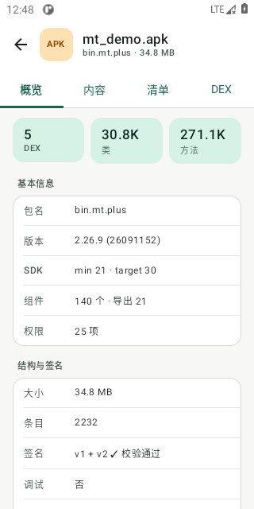 | 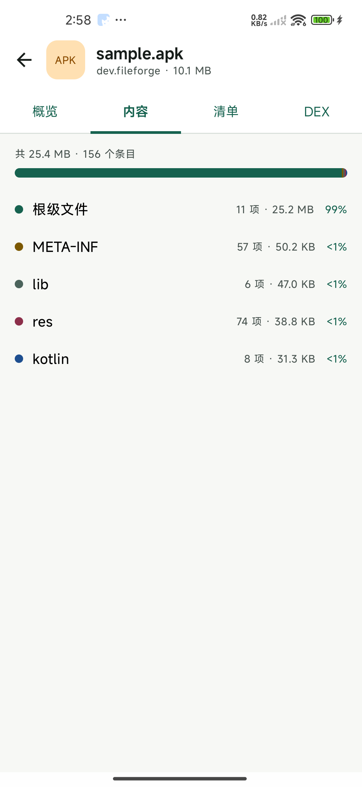 | 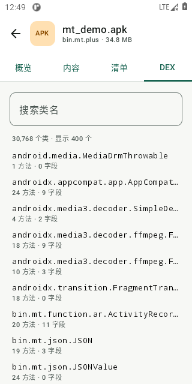 |

压缩包内浏览：zip/jar/7z/rar 点进去都像普通文件夹（魔数识别，不靠扩展名），面包屑以压缩包名为界；选中条目「复制」即解压到另一栏，顶层目标自动去重命名防覆盖。

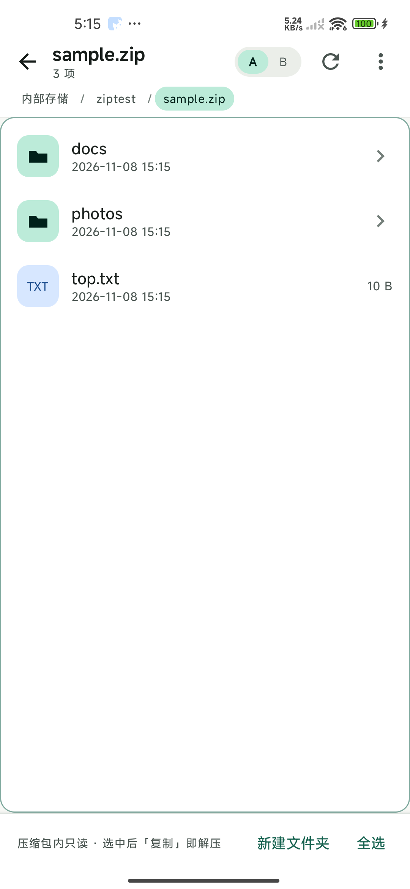

| 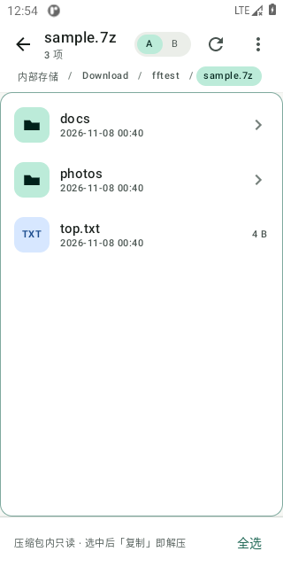 | 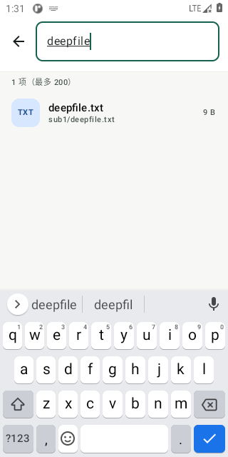 |

搜索：顶栏放大镜进入，递归当前目录按文件名匹配（忽略大小写），结果显示相对路径与大小，点击按类型正常打开（目录则跳转）；深度 14 层封顶、canonical 路径去重防符号链接循环、结果上限 200，返回键先退搜索。书签：星标菜单收藏常用目录（SharedPreferences 持久化），一键跳转、单条删除。

| 书签 |
| --- |
| 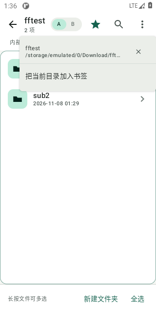 |

应用管理：⋮ 菜单进入，已装应用一目了然；点应用弹「提取安装包 / 应用信息」——提取到 Download 后可在文件浏览器直接点开做 APK 检查，形成闭环。

| 应用列表 | 提取产物再检查 |
| --- | --- |
| 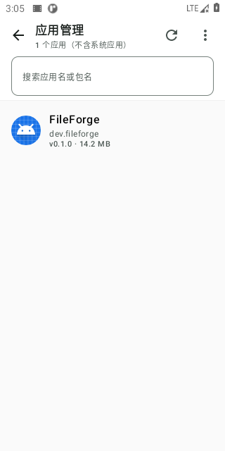 | 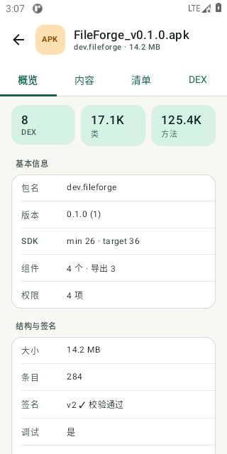 |

文件查看器：点文件即按类型分流——文本（行号 + 等宽，>512 KB 截断提示）、图片（双指缩放 1–8 倍，降采样到 ≤2048 px 防大图 OOM）、十六进制（偏移 + HEX + ASCII 三列，>8 KB 只读前 8 KB 并提示）。压缩包内的文件先解压到 cache 再预览，头路径如实显示缓存位置。

| 文本 | 图片 | 十六进制 | zip 内预览 |
| --- | --- | --- | --- |
| 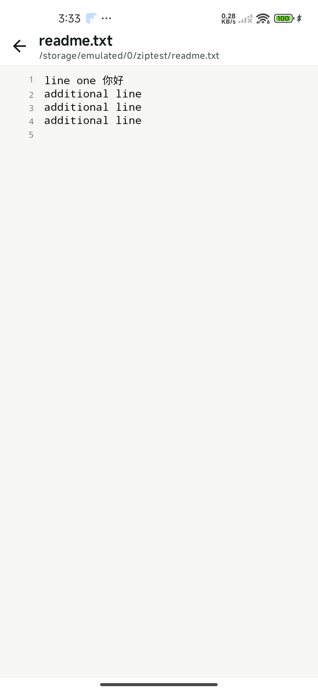 | 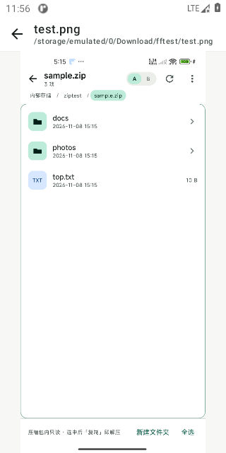 | 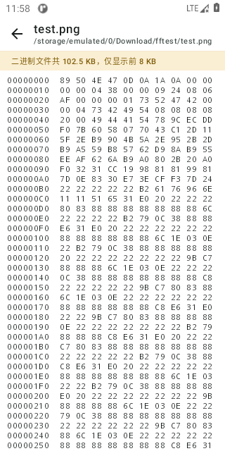 | 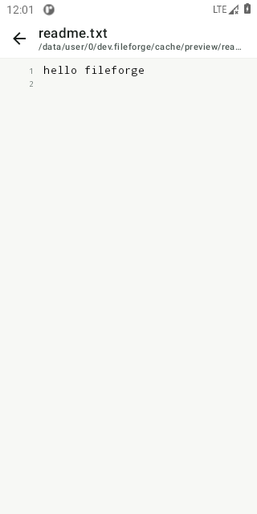 |

设计要点：顶部是「目录名 + 路径面包屑」两级结构，路径不再截断；文件行用类型色块（文件夹、APK、压缩包、图片、音视频、文本）做视觉锚点，右侧只保留一项信息（文件夹给箭头、文件给大小、选中给对勾）；底部栏无选中时是「新建 / 全选」，有选中时收敛为「复制 / 移动 / 重命名 / 更多」，不再横向溢出。

## 已实现

- 双栏文件管理：宽屏并排、窄屏切页；面包屑、按名称/大小/时间排序、显示隐藏文件、多选。
- 文件操作：复制到另一栏、移动、重命名、删除、新建文件夹、zip 压缩/解压（含 zip-slip 防护）。
- zip/jar/7z/rar 内浏览：虚拟路径 `zip://archive!/inner`（四种格式共用），魔数识别格式；目录聚合（含目录总大小），选中条目复制即选择性解压；包内只读，删除/重命名/新建被拒绝并提示。rar 支持到 RAR4（junrar 上限）。
- 文件查看器：文本 / 图片 / 十六进制三种视图，压缩包内文件可直达预览（先解压到 cache）。
- 文件搜索：递归当前目录（深度 14 / 上限 200 / 可取消），点结果按类型打开。
- 书签：常用目录收藏与一键跳转，持久化保存。
- 应用管理：已装应用列表（图标/包名/版本/大小，可搜应用名或包名，可切换显示系统应用），一键提取安装包到 Download——普通应用存为单个 `应用名_v版本.apk`，含 split APK 的 App Bundle 应用存为同名文件夹（base + 所有 split），大文件走 sendfile。
- APK 检查：包名/版本/SDK/权限/组件/导出组件、内容分组占比、apksig v1/v2/v3 完整签名校验（验证证书与摘要，不止探测方案存在）、多 DEX 类与方法统计（native 批量扫描）、类名搜索（点分包名与斜杠描述符等价）。
- 系统返回键在 APK 详情页回到列表，不会直接退出应用。

## 性能

MT 管理器 2.26.9（34.8 MB，5 个 DEX，30,768 类 / 271,128 方法）实测：

| 操作 | Kotlin 实现（桌面 JVM） | native 实现（模拟器 arm64） |
| --- | --- | --- |
| 解析二进制 AndroidManifest | 15 ms | — |
| 全量扫描 5 个 DEX | 718 ms（约 25 MB/s） | **74 ms（约 345 MB/s）** |

native 化的关键不是"用 C 写一遍"，而是**换掉数据形态**：C 侧一次遍历产出单条文本（每类一行 `descriptor\tsuper\tmethods\tfields`），Java 侧不再为 3 万个类各建一个对象——DEX 页与搜索只物化真正要显示的 ≤400 行。

JNI 承担三处热点：大文件（≥4 MB）拷贝走 `sendfile` 零拷贝；签名块扫描走 `memchr` 跳跃搜索；DEX 批量扫描（上述）。其余留在 Kotlin，避免为小数据加 JNI 开销。

## 下一步

1. RAR5 支持（junrar 上限是 RAR4；纯 Java 方案暂缺，可评估 libarchive JNI）。
2. 已验证的回归测试脚本见 `tools/parser-check/`（APK 解析与 zip 解压均可脱离 Android 跑）。
